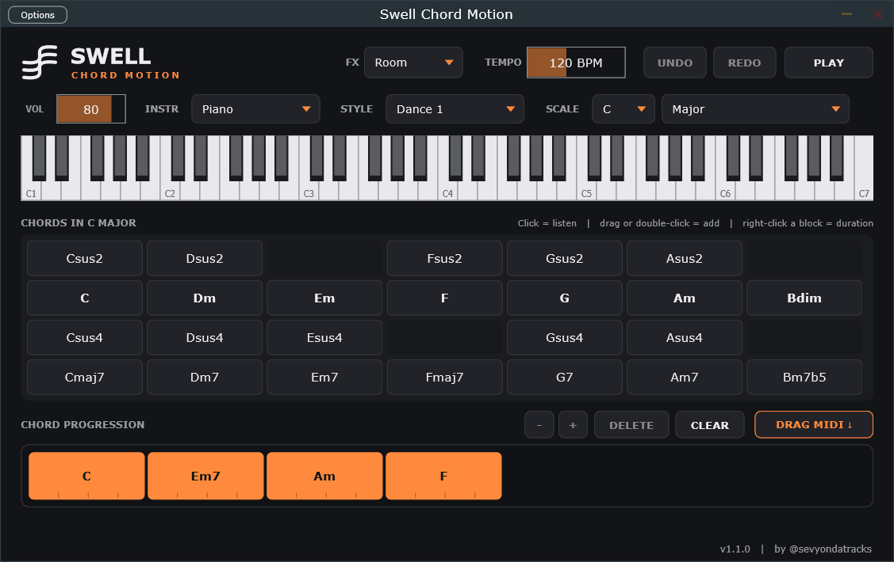

<p align="center">
  
</p>

<h1 align="center">Swell Chord Motion</h1>

<p align="center">
  Générateur de progressions d'accords — <b>Standalone</b>, <b>VST3</b> (Windows / Mac) et <b>AU</b> (Mac)<br>
  par <b>Swell</b> · <a href="https://github.com/sevYOnDaTracks">@sevyondatracks</a>
</p>

---

## Le principe

Tu choisis une gamme, tu cliques sur les accords pour les écouter, tu les glisses dans ta progression, tu choisis un style d'accompagnement… et tu glisses le résultat en MIDI directement dans ton DAW.

Le fonctionnement s'inspire du [Chord Player de OneMotion](https://www.onemotion.com/chord-player/), en version plugin.

## Fonctionnalités

| | |
|---|---|
| **Palette d'accords** | Tous les accords de la gamme choisie, sur 4 lignes : sus2, accords de base, sus4 et 7e |
| **12 tonalités × 8 gammes** | Major, Minor, Harmonic major/minor, Melodic minor, Double harmonic major, Neapolitan major/minor |
| **Chord progression** | Glisser-déposer, réorganisation des blocs, durée par accord (1 à 16 temps), Undo / Redo |
| **20 styles** | Basic, Pop, Dance, Rock, Swing, Waltz, Reggae, Bossa Nova, Funk, Strumming, Arp, Melodic |
| **Instruments intégrés** | Piano, E-Piano, Organ, Pad, Pluck, Strings + reverb (Room, Hall, Church) |
| **MIDI Out** | Pilote tes propres VST avec la progression |
| **Synchro DAW** | Suit le tempo et la lecture de ton DAW |
| **DRAG MIDI** | Glisse la progression en `.mid` dans ta playlist (FL Studio, Ableton, Logic…) |
| **SWELL KEY** | Un clic règle KEY et SCALE sur la gamme trouvée par le plugin Swell Key |

## Utilisation

1. **SCALE** : choisis la tonalité et la gamme. La palette se met à jour.
2. **Clic sur un accord** : tu l'entends tout de suite.
3. **Glisse-le** dans *Chord Progression*, ou **double-clique** dessus pour l'ajouter à la fin.
4. Dans la progression :
   - **glisse un bloc** pour le déplacer ;
   - **clic droit** sur un bloc pour régler sa durée, le dupliquer ou le supprimer ;
   - **- / +** pour changer la durée de l'accord sélectionné.
5. **STYLE** et **INSTR** : choisis le rythme et le son, puis **PLAY**.
6. **DRAG MIDI** : glisse le bouton dans ton DAW. Un simple clic ouvre le dossier des exports (`Documents/Swell Chord Motion`).

> Astuce FL Studio : mets **INSTR** sur `MIDI Out`, puis route la sortie MIDI du plugin vers n'importe quel instrument.

## Lancer le Standalone

**Windows** : double-clique sur

```
build\SwellChordMotion_artefacts\Release\Standalone\Swell Chord Motion.exe
```

Au premier lancement, clique sur **Options** (en haut à gauche) puis **Audio/MIDI Settings** pour choisir ta carte son.

**Mac** : ouvre `build-mac/SwellChordMotion_artefacts/Release/Standalone/Swell Chord Motion.app`.

## Installer le plugin

| Format | Fichier généré | Où le copier |
|---|---|---|
| VST3 Windows | `build\SwellChordMotion_artefacts\Release\VST3\Swell Chord Motion.vst3` | `C:\Program Files\Common Files\VST3\` |
| VST3 Mac | copié automatiquement | `~/Library/Audio/Plug-Ins/VST3/` |
| AU Mac | copié automatiquement | `~/Library/Audio/Plug-Ins/Components/` |

Relance ensuite un scan des plugins dans ton DAW.

## Compiler depuis les sources

Le projet utilise [JUCE 8](https://juce.com), téléchargé automatiquement par CMake.

### Windows

Prérequis : [Visual Studio Build Tools 2022](https://visualstudio.microsoft.com/downloads/) (charge « Développement Desktop en C++ »), CMake et Git.

```powershell
winget install Kitware.CMake
winget install Microsoft.VisualStudio.2022.BuildTools --override "--wait --passive --add Microsoft.VisualStudio.Workload.VCTools --includeRecommended"
.\build.ps1
```

### Mac (Standalone + VST3 + AU, Apple Silicon et Intel)

```bash
xcode-select --install
brew install cmake
chmod +x build-mac.sh && ./build-mac.sh
```

## Structure du code

```
Source/
├── ChordEngine.h        théorie musicale, palette, styles, génération des notes
├── SwellSynth.h         instruments intégrés
├── PluginProcessor.*    paramètres, progression (undo/redo), synchro DAW, export MIDI
├── PluginEditor.*       interface : palette, progression, clavier
└── SwellLookAndFeel.h   charte graphique Swell (couleurs, logo, boutons)
```

## Roadmap

- [ ] Instruments samplés (piano, Rhodes, guitare, cordes…)
- [ ] Onglet Melody
- [ ] Bibliothèque de progressions prêtes à l'emploi
- [ ] Sauvegarde / chargement de projets

---

<p align="center"><sub>Swell · Chord Motion v1.2.0 · by @sevyondatracks</sub></p>
